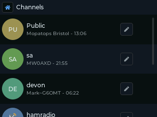
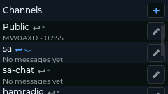
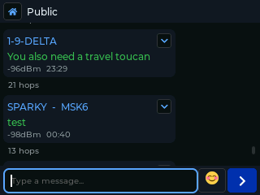

# Chat and channels

Open **Chat** from the launcher. The first screen lists your channels, with an unread
count and a preview of the last message, and a **Direct Messages** entry at the
bottom.

| T-Deck | Cardputer |
|:---:|:---:|
|  |  |

## Channels

A channel is a group chat. Everyone who has the channel's key can read it and post
to it.

- **Public** is always there. Every MeshCore node has its key, so treat it as open.
- You can add up to **9 more** channels.

### Adding a channel

Choose **+ Add Channel** at the top of the channel list (or use **Settings >
Channels**). Fill in:

- **Name.** A name starting with `#` (for example `#Mesh`) is a **hashtag
  channel**: leave the key empty and it is worked out from the name, so anyone who
  types the same name joins the same channel. Any other name (for example
  `MyGroup`) is a **private channel**: leave the key empty and a random key is made
  for you. Share it with the people you want in.
- **Key (PSK).** To join a private channel someone else made, paste their key here.

To see a channel's key so you can share it, type `channel <n>` in the
[Terminal](Terminal-Commands). `n` is the slot, 1 to 10 (1 is Public); `channels`
lists them. It prints the key in base64.

### Channel options

The **≡** button at the end of a channel's row opens its options:

- **Configure Scope**: which region this channel's messages are flooded to. See
  [Regions and scopes](Regions-and-Scopes).
- **Channel Icon** (Cardputer): initials or an emoji in front of the channel name.
  The T-Deck shows each channel's initials in a circle instead.
- **Clear Messages**: empties the conversation.
- **Notify: On / Off**: popups and sounds for this channel.
- **Delete Channel** (not for Public).

## Reading and sending

Open a channel to see its conversation as speech bubbles: yours on the right, others
on the left with the sender's name. Type a message and press Enter to send.

| T-Deck | Cardputer |
|:---:|:---:|
|  | *(screenshot to come)* |

Under messages you sent to a channel, **repeated ×N** shows how many times
repeaters were heard passing it on: a sign it got out.

Select a message bubble to open its menu (on the T-Deck tap the bubble's menu
button; on the Cardputer move to the bubble and press Enter):

- **Reply**: starts your message with `@[Name]`.
- **Show Path**: the repeaters the message came through.
- **Add Contact**: saves the sender as a contact, if their advert has been heard.

With **Settings > Show Hops** and **Show RSSI** on, each received message also shows
how many hops it took and its signal strength.

## Direct messages (DMs)

A DM goes to one contact only, encrypted so that only the two of you can read it.

- **Start one:** open **Contacts**, select the person and choose **Direct Message**,
  or open **Direct Messages** in Chat.
- **Delivery:** a tick appears on your bubble when the recipient's device confirms it.
  If no confirmation comes back, Saitama resends it: first along the known route,
  then as a flood (**Settings > DM Retries**, 5 and 3 by default). If every try
  fails the bubble shows **✕ Not delivered**. See
  [Getting your message through](Message-Reliability).
- **Green padlock = verified.** See below.

### Verified DMs (the green padlock)

Every DM is encrypted and checked with a key that only you and that contact can work
out: each side combines its own private key with the other's public key. A message
that wasn't made with your contact's private key fails the check, so a DM **can't be
forged in their name**.

- **T-Deck:** a green padlock beside the sender's name on each verified message.
- **Cardputer:** a green padlock in the conversation's title bar.

Channel messages have no padlock and **can't** be verified: anyone with the channel
key can post under any name. When it matters who sent something, use a DM.

The details: the contact's public key is trusted from the first advert you save for
them, and the check is MeshCore's 2-byte message authentication code (MAC), not a
full digital signature.

You can only DM someone after you've heard their advert (or saved them from a QR
code), and they can only DM you after hearing yours.

## History

With **Settings > Save Messages** on (the default), every conversation is saved to
the SD card in `/ops/msgs/` and reloaded when you open it. The Cardputer keeps
fewer messages in memory per conversation than the T-Deck (10 rather than 20); older
ones stay on the card.

## Notifications

**Settings > Notifications** turns the new-message popup on or off.
**Settings > Notification Sound** picks the sound (Default, Pluck, Clear or Whoosh)
and **Settings > Speaker** sets the volume. Sounds are muted during Night Mode.
