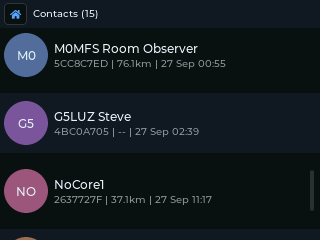

# Contacts, Repeaters and Heard

MeshCore nodes announce themselves with **adverts**. Saitama sorts what it hears into
three apps:

- **Heard**: every station heard since the device was switched on.
- **Contacts**: people (companion nodes) you've saved. Up to 250 on the T-Deck,
  100 on the Cardputer.
- **Repeaters**: repeaters you've saved. Up to 250 on the T-Deck, 60 on the Cardputer.

Contacts and repeaters are saved to the SD card (`/ops/contacts.json` and
`/ops/repeaters.json`) and survive a reflash.

## Heard

A live list of stations, newest first. Each row shows **C** (companion) or **R**
(repeater), the name, signal bars for the last packet heard, and (T-Deck only) the
time it was last heard.

Select a row for its details: name, identity, signal and, for a repeater, its owner
information (asked for over the air; it can take a few seconds). **Save** adds it to
Contacts or Repeaters; **Update** refreshes a saved one. **Clear List** (top right)
empties the list.

## Adding contacts

Any of these work:

- **Automatically:** **Settings > Auto Add Contacts** saves nodes as their adverts
  arrive.
- **From Heard:** select the station and choose **Save**.
- **From a message:** select the bubble in Chat and choose **Add Contact**.
- **QR code:** **Settings > Share My Contact** shows your own QR code for another
  device or the MeshCore phone app to scan.
- **Terminal:** `card` prints your business card; `import <card>` adds someone
  else's.

## Contacts

The list shows a star beside favourites, signal bars, and a speech-bubble button
that opens a DM straight away. Type to filter the list by name.

Select a contact for its options:

| | |
|---|---|
| **Direct Message** | |
| **Share QR** | **Details** |
| **Favourite** / **Remove Favourite** | |
| **Set Path** | **Reset Path** |
| **Delete Contact** | **Block Contact** |

- **Details:** ID, when last heard, signal, hop count, route, distance and position
  (if they share it), and their public key.
- **Set Path / Reset Path:** fix the route DMs take, or forget it so the next DM
  floods and a new route is learned.
- **Block Contact:** their DMs and channel messages are dropped and no longer shown.

## Repeaters

The same layout as Contacts. Select a repeater for:

| | |
|---|---|
| **Admin Login** | |
| **Add / Remove Favourite** | |
| **Set Path** | **Reset Path** |
| **Trace Repeater** (T-Deck) | **Delete Repeater** |

### Repeater admin

If you know a repeater's admin password you can manage it from the device.

1. Choose **Admin Login** and type the password.
2. Tick **Remember password** to keep it for next time (sealed with your storage
   password on the SD card). On the Cardputer, press Down to reach the tickbox and
   Enter to tick it.
3. Press Enter, or choose **Login**.

If the login fails you can **Retry**, or **Reset & Retry**, which forgets the stored
route so the login floods across the mesh.

Once logged in, the admin panel has:

- **Status:** battery, radio, packet counts, airtime, uptime and any sensor readings.
- **Neighbours:** the repeaters it can hear, with names.
- **Change Password**, **Access Control** (who may log in), and **Regions** (which
  region scopes it serves).

Any other repeater command can be sent from the Terminal with `repadmin <cmd>`.
