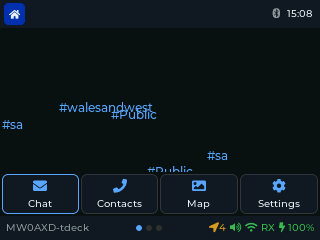
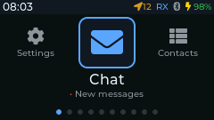

# Saitama user guide

Saitama is free, open-source firmware that turns a LoRa handheld into a standalone
[MeshCore](https://github.com/meshcore-dev/MeshCore) messenger. You get encrypted
channels and direct messages, a list of every station you hear, repeater and region
tools, and (on the T-Deck) offline maps. No phone, internet or subscription is needed.

Highlights:

- **Full touchscreen on the T-Deck.** Tap, swipe and scroll on every screen, like a
  phone, with the keyboard and trackball still there when you want them.
- **Verified direct messages.** A green padlock shows a DM really came from that
  person and wasn't faked.
- **Messages that get through.** Clear delivered / not-delivered ticks, automatic
  resends that find a new route when the old one breaks, and routes remembered
  across restarts.
- **No phone, no internet, no subscription.** Everything runs on the device.

New to all this? Start with [Why a mesh?](Why-Mesh), [Why Saitama?](Why-Saitama)
and [The apps explained](Apps-Explained).

This guide covers release **1.6.2** on both supported devices:

| | LilyGo T-Deck Plus | M5Stack Cardputer ADV |
|---|---|---|
| Status | Main target, hardware-tested | Beta, hardware-tested |
| Screen | 320 × 240, **full touch support** | 240 × 135, no touch |
| Input | Keyboard, trackball, touchscreen | Keyboard only |
| Radio | Built-in SX1262 | Cap LoRa-1262 module |
| GPS | Built-in | On the Cap LoRa-1262 |
| Firmware files | `saitama-t-deck-plus-X.Y.Z.bin` | `saitama-cardputer-adv-X.Y.Z.bin` |

## Contents

**Start here**

- [Why a mesh? Why MeshCore?](Why-Mesh): what this is all for
- [Why Saitama?](Why-Saitama): touchscreen, verified DMs, and what makes it different
- [Getting your message through](Message-Reliability): routing and delivery, explained
- [The apps explained](Apps-Explained): every app in plain English
- [Glossary](Glossary): the jargon, explained

**How-to guide**

1. [Installing Saitama](Installing-Saitama): download a release and flash it
2. [First setup](First-Setup): name, radio preset, storage password, clock
3. [Controls](Controls): keys, trackball and touch on each device
4. [The launcher](Launcher): finding your way round the apps
5. [Chat and channels](Chat-and-Channels): messages, DMs, channels, replies
6. [Contacts, Repeaters and Heard](Contacts-Repeaters-and-Heard): people and repeaters on your mesh
7. [Regions and scopes](Regions-and-Scopes): meshes whose repeaters only forward scoped traffic
8. [Network tools](Network-Tools): Finder, Trace, Signal and the radio tools
9. [Map and GPS](Map-and-GPS): offline maps (T-Deck) and GPS status
10. [Settings reference](Settings-Reference): every row in Settings
11. [Terminal commands](Terminal-Commands)
12. [Backup and security](Backup-and-Security): the SD card, storage password, Bluetooth PIN
13. [Troubleshooting](Troubleshooting)

The same identity, keys, contacts and settings work on both devices: the SD card's
`/ops/` folder can move from one to the other.
