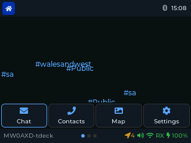
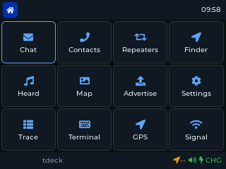
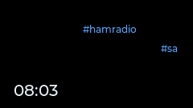

# The launcher

## T-Deck Plus

The launcher has three pages. Swipe left or right, or roll the trackball past the
edge of a page, to change page.

**Home page.** The stations you've heard this session fall like rain in the background,
coloured by signal strength, with channels in blue. When a message arrives, a line
joins it to its channel, the station it replies to, or the DM recipient. In front are
four big buttons: **Chat**, **Contacts**, **Map** and **Settings**. The clock and
battery are at the top; a moon beside the clock means Night Mode is on.

**Apps page 1:** Chat, Contacts, Repeaters, Finder, Heard, Map, Advertise, Settings,
ChanScan, Terminal, GPS, Signal.

**Apps page 2:** MP3, Files, Spectrum, Trace, SigGen, Power, Snake, 2048, PCAP,
BT Foxhunt, Pic Viewer, Regions.

## Cardputer ADV

The Cardputer has fewer apps (it has no PSRAM, so the radio tools, games and media
apps are left out, and the map is a lighter version):

**Chat, Contacts, Repeaters, Heard, Finder, Regions, Signal, GPS, Map, Terminal, Settings.**

**Carousel** (the default): one big icon at a time, with its neighbours at the
sides. Left and Right move round it, Enter opens the app. The line under the icon
shows something live for that app: unread messages, the number of contacts or
repeaters, the GPS fix, and so on.

**Menu:** **Settings > Launcher** switches between Carousel and Menu, a plain list
of the apps.

The Cardputer has no Advertise app: adverts are in **Settings > Advert**, and the
Terminal `advert` command sends one straight away.

## Screensaver

After the **Screen Timeout** (Settings) the screensaver starts. **Settings >
Screensaver** picks what it shows:

- **T-Deck:** a clock, or **Saitama** (an animated mesh).
- **Cardputer:** a clock, or **Mesh rain** (the default): channels, stations and the clock fall down the screen,
  joined by a line when a message arrives.

**Settings > Screen Off** turns the backlight off after a further delay. The radio
keeps listening, and messages still arrive.
