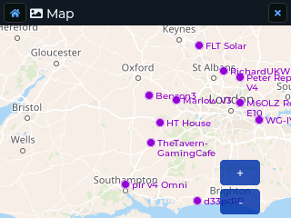

# Map and GPS

## GPS

**Settings > GPS** sets the receiver to **Off**, **Intermittent** (wakes now and then
to save battery) or **On**. The GPS needs a view of the sky for its first fix, which
can take a few minutes.

With a fix, the clock is set from GPS, and your position can be shared:

- **Settings > Location Sharing**: include your position in your adverts.
- **Settings > Telemetry**: whether others may ask your device for battery level and
  position.

The **GPS** app shows the fix:

- **T-Deck:** a sky plot of the satellites in view, with position, altitude and time.
- **Cardputer:** the same information as text.

## Offline map (T-Deck only)

The **Map** app shows map tiles from the SD card, with the positions of nodes that
share their location.



### Putting tiles on the card

Tiles go on the FAT32 SD card, one folder per style, in the usual
`{zoom}/{x}/{y}.png` layout:

```
/maps/osm/day/{z}/{x}/{y}.png      standard OpenStreetMap
/maps/osm/night/{z}/{x}/{y}.png    optional dark style
```

**With the included script** (from a copy of the Saitama repository):

```bash
python3 scripts/download_tiles.py \
    --output /Volumes/SD/maps/osm \
    --lat 51.5 --lng -0.1 --radius 20 --zoom 10-14
```

Use your own latitude and longitude. `--radius` is in kilometres. Stay within the
[OpenStreetMap tile usage policy](https://operations.osmfoundation.org/policies/tiles/):
the script is limited to 2 requests a second, and large areas at high zoom are a lot
of tiles.

**With a GUI tool:** [map-tiles-downloader](https://github.com/tekk/map-tiles-downloader).
Export standard OSM tiles and put them under `/maps/osm/day`.

### Night tiles

**Settings > Map Style** is **Day**, **Night** or **Auto** (the default: night tiles
while Night Mode is on). Without night tiles on the card, the day tiles are shown
colour-inverted at night, so no extra download is needed.
