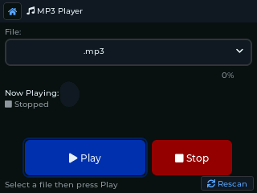

# Network tools

## On both devices

**Finder.** A zero-hop scan: it asks which nodes can hear you directly, without
going through a repeater, and lists them with their signal. Good for checking your
antenna and position, or finding the nearest repeater.

**Signal.** Live radio figures: last RSSI and SNR, the noise floor, packets sent and
received (flood and direct), errors, and airtime used for sending and receiving.

**Advert.** Tells nearby nodes you exist (see [First setup](First-Setup)).

- T-Deck: the **Advertise** app.
- Cardputer: **Settings > Advert** for the automatic interval (Off, 3, 6, 12 or 24
  hours), or `advert` in the Terminal to send one now.

Sending any advert, by hand or automatically, restarts the countdown to the next
automatic one.

## T-Deck only

The Cardputer has no PSRAM, so these are left out of its build.

| App | What it does |
|---|---|
| **Trace** | Follows a route hop by hop and shows the signal at each repeater. Also opened by **Trace Repeater** in the Repeaters app. |
| **ChanScan** | Checks the channels either side of the mesh frequency for LoRa activity, and shows how busy each one is. |
| **Spectrum** | A spectrum and waterfall view of the band. |
| **SigGen** | A signal generator, for testing. |
| **PCAP** | Captures received packets to the SD card for later analysis. |
| **BT Foxhunt** | Tracks a Bluetooth device by signal strength, beeping faster as you get closer. |
| **Power** | Battery history and estimated running time. |

## Media and extras (T-Deck only)

**MP3** player (from the SD card), **Pic Viewer**, **Files** (file manager), and the
games **Snake** and **2048**.

